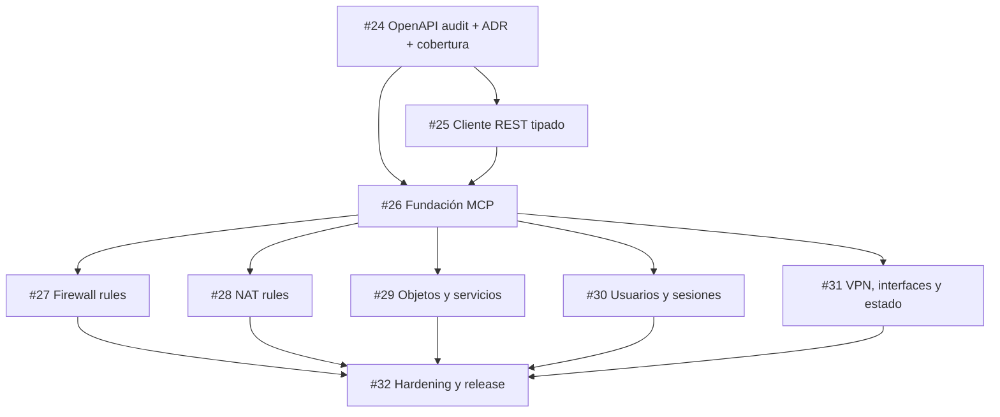

# Informe de auditoría independiente — Migración REST de Sophos Firewall MCP

**Fecha de la revisión:** 15 de noviembre de 2026, 10:27–11:05 (Europe/Madrid)  
**Repositorio:** https://github.com/lordraiden/sophos-firewall-mcp  
**Rama auditada:** `main` en `872997073843f30ee4d2291e2f03c184fc16f8d0`  
**Rama de correcciones:** `review/independent-audit-2026-11-15`  
**Alcance:** planificación (PLAN.md, REFERENCES.md, README.md), issues #24–#32 y contrato OpenAPI. **No se modificó código de aplicación, dependencias, workflows, Docker ni configuración de release.**

---

## 1. Conclusión ejecutiva

**Veredicto: el plan era sustancialmente correcto, con defectos concretos y corregibles; no era materialmente erróneo.** La arquitectura REST-only, el reparto en nueve issues, la política de no reintentar escrituras ambiguas, el mínimo privilegio Sophos y el transporte STDIO se sostienen frente a la evidencia primaria. El baseline del contrato (384 paths / 700 operaciones / 700 operationId únicos) se reprodujo exactamente.

**Confianza global: alta** en el contrato OpenAPI y en las afirmaciones MCP/SDK (verificadas contra el SDK 2.3.0 instalado, el `schema.ts` de 2026-07-28 y las páginas oficiales); **media** en el comportamiento del appliance, porque ningún dato procede de un firewall real.

Se corrigieron **14 defectos de planificación** y **9 issues**. Los más importantes:

1. **Device access vs Local service ACL (crítico para el operador).** El plan decía que la regla de excepción de Local service ACL no era un sustituto de Device access y que se investigara "solo si el firewall tiene una política adicional". Sophos documenta lo contrario: la regla de excepción es el **único mecanismo documentado** para permitir acceso restringido desde WAN a la consola/API, vive dentro de Administration > Device access y exige IPs de origen concretas (no `Any`/`0.0.0.0`). Corregido en PLAN.md §2 y en la issue #25.
2. **`openapi-python-client` desactualizado.** El plan exigía ≥0.29.1; el 7 de noviembre de 2026 se publicó GHSA-jg6c-wvfg-fx69, que afecta a 0.29.0–0.29.x y se corrige en **0.30.0**. Corregido en PLAN.md §6 y #24.
3. **La issue #27 inventaba un campo `status`.** El contrato usa `enabled` (boolean, **required**, default `true`). Una herramienta que omitiera `enabled` crearía una regla **habilitada**, violando la propia regla de seguridad de la issue. Corregido: `enabled` explícito, default MCP `false`, y decisión de excluir la variante WAF (`ruleType`).
4. **Contradicción #25 ↔ #26.** #25 pedía "coordinar" la interfaz del cliente con #26, que estaba bloqueada por #25. Corregido: #25 posee el contrato público (métodos, excepciones, `aclose`) y #26 lo consume.
5. **Criterios de aceptación no verificables** (evidencia de firmware sin protocolo, "un agente puede implementar sin inventar", "justificado"). Corregido con un protocolo de verificación en vivo (#24), un criterio medible y decisiones registradas.

**Lo que no se pudo probar:** compatibilidad con un SFOS concreto, comportamiento real de PATCH sobre arrays, truncamiento de `live-users` en `maxSize`, permisos efectivos de un perfil y respuesta de la API ante escrituras ambiguas. Todo ello queda marcado como pendiente de appliance.

---

## 2. Baseline de la auditoría

### 2.1 Repositorio

| Campo | Valor |
|---|---|
| Rama por defecto | `main` |
| HEAD | `872997073843f30ee4d2291e2f03c184fc16f8d0` — *docs: link independent migration review prompt* (2026-11-15 10:25 +01:00) |
| Fecha/hora de revisión | 2026-11-15, 10:27–11:05 Europe/Madrid |
| Issues auditadas | #24–#32, todas OPEN, sin labels ni milestone, títulos coincidentes |
| Estado del árbol | limpio; sin cambios de código de aplicación |

### 2.2 Contrato OpenAPI (`firewall_config_openapi.yaml`)

| Campo | Valor verificado |
|---|---|
| Tamaño | 8.934.475 bytes |
| Git blob SHA | `40fca0b25d4d85866f86b90aec77e5559ae27214` (coincide con el registrado) |
| SHA-256 | `58c4bc79ac930ce030202e09835865dcb12fcd44e9132e1f4234a1ed1743b1d5` |
| OpenAPI / API version | 3.0.0 / 1.0.0 (`info.title: Sophos Firewall Configuration API`) |
| Paths / operaciones | 384 / 700 (GET 263, POST 210, PATCH 134, DELETE 93; sin PUT/HEAD/OPTIONS) |
| operationId | 700 presentes, 700 únicos, 0 duplicados |
| Servidor | `https://{firewallHost}/api/firewall-config/v1`; default `172.16.16.16:4444` |
| Seguridad | `apiKey`: `type: http`, `scheme: bearer`, `bearerFormat: API key`; global en las 700 operaciones, 0 overrides |
| Esquemas | 32 componentes (0 sin usar, 0 ciclos); 76 `$ref` (32 únicos), 0 externos, 0 sin resolver; 4.265 esquemas inline / 162.760 nodos |
| PATCH | 134 operaciones, todas `application/json`; **0** `application/merge-patch+json`; 4 documentan merge por `name` en arrays |
| Paginación | 83 GET con `page`/`pageSize`/`pageTotal`; sin `limit`/`offset`/cursor; máximo 100 solo en `getUsers`, `getAdministrators`, `getNetworkUsers` |
| Identificadores | 260 name-or-id, 6 UUID-only (DHCP relays), 17 sin tipar; 0 path params solo-nombre |
| Códigos | 401/403/500 en las 700; 400 en 636; 404 en 272; 409 en 217; 201 en 92; 503 en 1 (`createIpsCustomSignature`) |
| Media types | 338 operaciones con body `application/json`; 1 `multipart/form-data` (`importTrustedMacs`, fuera de alcance) |

**Firmware objetivo:** no identificado. La ayuda y las release notes sitúan la REST API en SFOS 23.0 GA Build 371 (4 de noviembre de 2026), pero el portal de API Reference **no declara versión de SFOS** (solo la versión del contrato) y nada demuestra que el appliance del propietario ejecute ese build. Estado: **pendiente de verificación en vivo**.

---

## 3. Resumen de hallazgos

Severidad: **Crítica** = puede causar una acción insegura o bloquear la implementación; **Alta** = contradicción factual o criterio no verificable; **Media** = imprecisión con impacto operativo; **Baja** = mantenibilidad; **Info** = sin cambio necesario.

| # | Sev. | Tema | Sección del plan | Issues | Estado |
|---|---|---|---|---|---|
| 1 | Crítica | Device access vs Local service ACL mal descrito; el acceso WAN solo se documenta por la regla de excepción | §2 | #25 | Corregido |
| 2 | Crítica | #27 inventa `status`; el campo real es `enabled`, required, default `true` | §4 | #27 | Corregido |
| 3 | Crítica | #27 omite el discriminador `ruleType` (firewall/WAF) y la asimetría IPv6 | §4 | #27 | Corregido |
| 4 | Alta | `openapi-python-client` ≥0.29.1 queda afectado por GHSA-jg6c-wvfg-fx69; mínimo real 0.30.0 | §6 | #24 | Corregido |
| 5 | Alta | Criterios de aceptación de evidencia de firmware sin protocolo ni escape | §10 | #27–#32 | Corregido |
| 6 | Alta | Handoff circular #25↔#26 sin interfaz definida | §3, §7 | #25, #26 | Corregido |
| 7 | Alta | Criterio no verificable "un agente puede implementar sin inventar" | §9 | #24 | Corregido |
| 8 | Alta | Duplicación del 34,4 % del texto de las issues (cabecera de 4.615 caracteres × 9) | §9 | #24–#32 | Mitigado (nota de fuente canónica) |
| 9 | Media | `message` obligatorio (1–600) no estaba fijado en la desconexión de sesiones | §4 | #30 | Corregido |
| 10 | Media | Lista de no soportadas presentada como fiable; es no exhaustiva e internamente inconsistente | §2 | #24 | Corregido |
| 11 | Media | Firewall Health Check descrito como "vista de salud"; es cumplimiento de políticas | §4 | #31 | Corregido |
| 12 | Media | Atadura de versión del portal de API imprecisa | §2 | #24 | Corregido |
| 13 | Media | Formatos `sfos-object-name*` no asertivos (994/1.085 sin `pattern`) | §5 | #24 | Corregido |
| 14 | Media | `subscriptions=False` sin matiz de alcance (solo clientes 2026-07-28) | §7 | #26 | Corregido |
| 15 | Media | `openWorldHint` justificado por "datos externos", no por dominio de interacción | §7 | #26 | Corregido |
| 16 | Media | Regla de raíz de objeto presentada como requisito, no como convención | §7 | #26 | Corregido |
| 17 | Media | Roots/Sampling/Logging "deprecados" sin precisar que no se eliminaron | §7 | #26 | Corregido |
| 18 | Media | Matriz Python sin 3.14 y con discrepancia SDK 3.10 vs docs 3.11+ | §11 | #26, #32 | Corregido |
| 19 | Media | #28 afirmaba "puede incluir bulk-delete" y presuponía discriminadores SNAT/DNAT inexistentes | §4 | #28 | Corregido |
| 20 | Media | #31 delegaba la decisión de mutaciones VPN al implementador | §4 | #31 | Corregido |
| 21 | Baja | `docs/API-COVERAGE.md` con nueve dueños y `.env.example` con dos | §9, §11 | #24, #25, #32 | Corregido |
| 22 | Baja | Términos cuantitativos sin definir ("bounded", "one page", "sanitized") | §7 | #26–#31 | Parcial (página ≤100 en #29) |
| 23 | Info | PATCH JSON Merge Patch, base URL, Bearer, naming, paginación de usuarios y live-users, endpoints de estado, ausencia de rule groups e IPv6 IPsec | §2–§5 | — | Verificado, sin cambio |

---

## 4. Tabla de conformidad MCP (protocolo 2026-07-28 y SDK 2.3.0)

Fuentes: `schema.ts` 2026-07-28 ([R37](https://github.com/modelcontextprotocol/modelcontextprotocol/blob/main/schema/2026-07-28/schema.ts)), changelog ([R38](https://modelcontextprotocol.io/specification/2026-07-28/changelog)), registro de versiones del SDK ([R39](https://github.com/modelcontextprotocol/python-sdk/blob/main/src/mcp_types/version.py)), release v2.3.0 ([R35](https://github.com/modelcontextprotocol/python-sdk/releases/tag/v2.3.0)), y código instalado en `.venv` (`mcp==2.3.0`).

| Requisito / afirmación | Evaluación del plan | Evidencia | Corrección |
|---|---|---|---|
| `MCPServer(..., subscriptions=False)` desactiva `subscriptions/listen` | Correcto, pero sin matiz | Firma real en `mcp/server/mcpserver/server.py:184`; `on_subscriptions_listen=None` en `:229`; release v2.3.0; por defecto se crea `InMemorySubscriptionBus` | Añadido que el default anuncia `listChanged`/`subscribe` y que el efecto solo lo ven clientes 2026-07-28 |
| Raíz de objeto obligatoria en la salida | Impreciso | `schema.ts`: `structuredContent?: unknown`, `outputSchema` cualquier JSON Schema 2020-12; restricción a objeto solo hasta 2025-11-25; el SDK envuelve listas/escalares en `{"result": ...}` (`func_metadata.py:214`, `:614`) | Reescrito como convención de interoperabilidad, no requisito |
| `openWorldHint=true` por ser un appliance externo | Impreciso | `schema.ts`: "may interact with an 'open world' of external entities… Default: true"; es dominio de interacción, no confianza en datos | Reescrito: decidir por herramienta; la confianza en la salida va en §8 |
| Roots/Sampling/Logging deprecados | Correcto, incompleto | Registro de deprecaciones SEP-2577; `ping`, `logging/setLevel` y `notifications/roots/list_changed` **eliminados**; el SDK los mantiene para clientes heredados | Precisado "deprecados, no eliminados" y la lista de eliminados |
| 2026-07-28 elimina `initialize` y sesiones; el SDK gestiona compatibilidad | Correcto | `schema.ts` no tiene `initialize`; `server/discover` es MUST; `version.py`: handshake 2024-11-05…2025-11-25 + modern 2026-07-28 | Añadidas las cuatro revisiones heredadas y el matiz de `mode="legacy"` |
| `mcp>=2.3.0,<3`; v2.3.0 es la última | Correcto | PyPI 2.3.0 (2026-10-02), GitHub releases, sin parche posterior | Añadida la discrepancia Python >=3.10 (metadatos) vs 3.11+ (docs) |
| `ToolError` para fallos previstos; `MCPError` para protocolo; inesperadas al SDK | Correcto | `exceptions.py`: `UnexpectedToolError` solo expone `Error executing tool <name>`; `_handle_call_tool` registra traceback | Sin cambio de fondo; añadido a #26 |
| `Context[AppContext]` inyectado y fuera del input schema | Correcto | `tools/base.py:99-104` (`skip_names`), `ctx.request_context.lifespan_context` | Añadidos campos de `AppContext` y firma de registro |
| `extra=forbid` en contratos cerrados | Presente en el plan, sin dueño | PLAN.md §7 | Añadido como AC de #26 |
| `content`/`structuredContent` sin duplicar | Presente en el plan, sin dueño | PLAN.md §7 | Añadido como AC de #26 |
| Recursos y prompts soportados; suscripciones activas por defecto | No evaluado | `MCPServer` registra recursos/prompts; suscripciones ON salvo `False` | Documentado |

**Conclusión MCP:** el plan no contenía errores de protocolo graves; contenía **imprecisiones de justificación** que habrían hecho que un agente implementara reglas por la razón equivocada (raíz de objeto, `openWorldHint`, deprecaciones). Todas corregidas.

---

## 5. Tabla de conformidad Sophos

Fuentes: overview ([R01](https://docs.sophos.com/nsg/sophos-firewall/rest-api/index.html)), API Reference ([R02](https://docs.sophos.com/nsg/sophos-firewall/rest-api/api/firewall-config-openapi/sophos-firewall-configuration-api/index.html)), API access y keys ([R04](https://docs.sophos.com/nsg/Sophos-firewall/23.0/Help/en-us/webhelp/onlinehelp/AdministratorHelp/Administration/APIRestAPI/APIAccessAndKeys/index.html)), Device access best practices ([R33](https://docs.sophos.com/nsg/sophos-firewall/23.0/help/en-us/webhelp/onlinehelp/AdministratorHelp/Administration/DeviceAccess/DeviceAccessBestPractices/index.html)), allow-access ([R22](https://docs.sophos.com/nsg/sophos-firewall/22.0/help/en-us/webhelp/onlinehelp/AdministratorHelp/Administration/API/HowToArticles/APIAllowAccess/)), interfaces ([R34](https://docs.sophos.com/nsg/sophos-firewall/23.0/help/en-us/webhelp/onlinehelp/AdministratorHelp/Network/Interfaces/index.html)) y el YAML versionado.

| Hecho | Evaluación del plan | Evidencia | Corrección |
|---|---|---|---|
| Base URL `https://<host>:<port>/api/firewall-config/v1`; puerto admin 4444 por defecto | Correcto | Overview R01; `servers` del YAML; ayuda 23.0 | Sin cambio |
| API key Bearer; hereda permisos del perfil; 10/admin, 1.024/appliance, 1 año; todos ven la lista; default admin revoca cualquiera; rotación manual | Correcto | R04 (texto verbatim) | Añadido "super administrator" = default admin |
| Perfiles None/Read-only/Read-write por función | Correcto | R21/R28 | Sin cambio |
| API access off por defecto; allowlist máximo 64 entradas | Correcto | R04 | Sin cambio |
| Device access (ACL por zona) y regla de excepción para WAN | **Incorrecto** | R22: "You can configure the local service ACL exception rule to allow access to the web admin console and API from the WAN zone for specific administrator IP addresses and networks"; R33: no se puede habilitar para todo WAN | Reescrito en PLAN §2 y #25 |
| PATCH = JSON Merge Patch (RFC 7396) por defecto salvo excepción | Correcto | R02 y `info.description` del YAML, verbatim | Añadida la evidencia local y las 4 excepciones |
| 134/134 PATCH `application/json`; 0 `merge-patch+json` | No estaba | YAML | Añadido a PLAN §5 y #24/#25 |
| Formatos `sfos-object-name*` | Correcto en definición, sin enforcement | R02; YAML: 994/1.085 sin `pattern` | Añadida la advertencia de validación en cliente |
| Lista de no soportadas no exhaustiva | Correcto, incompleto | R04: firewall rule groups, IPsec routes/GRE/L2TP/PPTP, SSL VPN site-to-site, wireless, RED, SD-WAN profiles, status info | Añadida su inconsistencia interna (wireless/hotspot, DHCP leases) |
| Firmware 23.0 GA Build 371 | Correcto como dato, mal atado al portal | R05; el portal no declara versión SFOS | Precisado en PLAN §2 |
| `getUsers` page/pageSize/pageTotal 1/50/false, max 100 | Correcto | YAML | Añadidos `nameContains`/`nameNotEquals` y los 83 GET |
| `getLiveUsers` sin paginación de petición; `items` + `pages{current,size,maxSize}` | Correcto | YAML | Añadido que `pages` no tiene `total`/`items` y el ejemplo 1000 |
| `disconnectLiveUser` con `liveUserId` y `message` | Correcto pero impreciso | YAML: ambos required; `message` 1–600; 200/400/401/403/500 | Corregido en PLAN §4 y #30 |
| Solo dos endpoints de estado; no hay health general | Correcto | YAML | Sin cambio |
| Firewall Health Check = cumplimiento de políticas | Impreciso | R24 | Corregido en PLAN §4 y #31 |
| `getSystemSettings` solo `hostname`/`loginDisclaimer`/`updatedAt` | Correcto el principio, no el detalle | YAML | Añadido el detalle |
| Interfaces CRUD; aviso de conectividad | Correcto el hecho, mal la fuente | R34 (ayuda, no API Reference) | Corregido en PLAN §4 y #31 |
| VPN: sin IPv6 site-to-site; `connections/ipv4` solo GET/DELETE/bulk delete | Correcto en lo esencial | YAML | Añadido el inventario exacto y la decisión read-only v1 |
| No reintentar escrituras ambiguas; GET sí | Correcto | R01, texto verbatim | Sin cambio |

**Conclusión Sophos:** el plan describía bien el contrato, pero **una afirmación de seguridad operativa era incorrecta** (Device access/ACL) y varias eran imprecisas. El contrato local es más rico de lo que el plan reflejaba: contiene la semántica PATCH, los formatos de nombre y las excepciones de arrays en su propio `info.description`.

---

## 6. Arquitectura recomendada

La arquitectura del plan es la correcta; se mantiene sin capas nuevas:

```text
MCP host (Claude Desktop / VS Code / Cursor)
  │  STDIO (stdout = protocolo, stderr = logs)
  ▼
MCPServer (SDK v2.3.0, subscriptions=False)
  ├── lifespan → AppContext(client, settings, read_only)
  ├── handlers tipados (Context[AppContext], Pydantic in/out)
  ├── domain adapters (firewall, NAT, objetos, usuarios, VPN/estado)
  └── SophosRestClient (HTTPX async, Bearer, TLS on, timeout, sin redirects cross-origin)
        └── https://<host>:<port>/api/firewall-config/v1
```

**Decisiones ratificadas:** REST-only; un cliente asíncrono compartido; sin raw REST; sin router FastEmbed; STDIO local; anotaciones como hints; `ToolError` para fallos previstos; sin auto-paginación; sin reintento ciego de escrituras.

**Alternativas rechazadas:** cliente generado completo (el contrato tiene 32 esquemas de componente y 4.265 inline; el generado sería enorme y difícil de revisar); proxy HTTP genérico (rompe el modelo de seguridad y la ergonomía del agente); doble protocolo XML/REST (coste sin valor); Streamable HTTP/OAuth en v1 (no hay requisito de despliegue remoto).

**Adición recomendada:** el ADR de #24 debe fijar el **scaffolding del domain adapter** (hoy sin dueño explícito) para que #27–#31 no inventen cinco capas distintas. Se ha añadido esa responsabilidad a #26.

---

## 7. Alcance de herramientas del primer release

Derivado del contrato y de las decisiones del plan (no del XML):

| Dominio | operationIds en alcance | Superficie MCP propuesta | Excluido / diferido |
|---|---|---|---|
| Firewall rules IPv4/IPv6 | `getAllFirewallRulesIpv4/Ipv6`, `getFirewallRuleIpv4/Ipv6`, `createFirewallRuleIpv4/Ipv6`, `updateFirewallRuleIpv4/Ipv6`, `deleteFirewallRuleIpv4/Ipv6`, `moveFirewallRuleIpv4/Ipv6` | list/get/create/update/delete/move separados por familia | `bulkDeleteFirewallRules*`, WAF (`ruleType: waf`), rule groups (no existen en el contrato) |
| NAT rules IPv4/IPv6 | `getAllNatRulesIpv4/Ipv6`, `getNatRuleIpv4/Ipv6ByIdOrName`, `createNatRuleIpv4/Ipv6`, `updateNatRuleIpv4/Ipv6ByIdOrName`, `deleteNatRuleIpv4/Ipv6ByIdOrName`, `moveNatRuleIpv4/Ipv6` | CRUD + move por familia | `bulkDeleteNatRules*` |
| Addresses | `getAllIpAddresses`, `getAllIpv6Addresses`, `getAllFqdns`, y sus get/create/update/delete | IPv4, IPv6, FQDN | MAC (clasificado, diferido) |
| Address groups | `getAllIpv4AddressGroups`, `getAllIpv6AddressGroups`, `getAllFqdnGroups`, y CRUD | Grupos por familia | Country groups (clasificados, diferidos) |
| Services | `getAllServices`, `getServiceByIdOrName`, `createService`, `updateServiceByIdOrName`, `deleteServiceByIdOrName` | Servicios | `bulkDeleteServices` |
| Service groups | `getAllServiceGroups`, `getServiceGroupByIdOrName`, `createServiceGroup`, `updateServiceGroupByIdOrName`, `deleteServiceGroupByIdOrName` | Grupos de servicios | `bulkDeleteServiceGroups` |
| Users | `getUsers`, `getNetworkUsers`, `getNetworkUser`, `createNetworkUser`, `updateNetworkUser`, `deleteNetworkUser` | Listado general + CRUD de network users | Administradores y user groups (excluidos), login/logout (clasificados, no registrados) |
| Live sessions | `getLiveUsers`, `disconnectLiveUser` | Listar y desconectar una sesión | Desconexión masiva (no existe) |
| VPN | `getProfiles`, `getProfile`, `getFailovergroups`, `getFailovergroup`, `listIpsecConnectionsIpv4`, `listIpsecPolicyBasedConnectionsIpv4`, `getPolicyBasedIpsecConnectionIpv4`, `listIpsecRouteBasedConnectionsIpv4`, `getRouteBasedIpsecConnectionIpv4`, `getIpsecSiteToSiteLiveConnectionsIpv4`, `getIpsecRemoteAccessVpnSettings`, `getRemoteAccessPolicies`, `getRemoteAccessPolicy`, `listBookmarkGroups`, `getBookmarkGroup`, `getBookmarks`, `getBookmark`, `listClientlessPolicies`, `getClientlessPolicy`, `getSslvpnGlobalSettings` | Lectura: configuración vs estado live | Toda mutación VPN (decisión v1), SSL VPN site-to-site (no soportado) |
| Interfaces | `listNetworkInterfaces`, `getNetworkInterface` | Lectura | `createNetworkInterface`, `updateNetworkInterface`, `deleteNetworkInterface` |
| Estado | `getDnsProtectionStatus`, `getCellularWanStatus` | Dos herramientas concretas | Cualquier "firewall health" genérico, modelo/serie/firmware/uptime |

---

## 8. Resultado issue por issue

Todas las issues fueron corregidas en GitHub el 15 de noviembre de 2026. Recomendación final: **0 cerrar, 0 fusionar, 0 dividir, 9 mantener con enmiendas aplicadas.**

| Issue | Estado | Cambios aplicados | Problemas restantes |
|---|---|---|---|
| **#24** Audit OpenAPI + cobertura | Enmendada | SHA-256, 32 esquemas, 0 refs externos, 83 GET paginados, distribución de identificadores, evidencia PATCH del propio YAML + 4 excepciones, `openapi-python-client` 0.30.0 + GHSA nuevo, ADR con ruta, POC acotada, propiedad de secciones de API-COVERAGE, protocolo de verificación en vivo, AC medible | El generador sigue dentro de #24 (se descartó dividir para mantener nueve issues); el AC del generador es exigible y está en la lista |
| **#25** Cliente REST | Enmendada | Contrato público propio (métodos, excepciones, `aclose`), corrección del default TLS real, redacción correcta de Device access/ACL, retry cuantificado (2 intentos, 502/503/504), media types, `.env.example` propiedad de #25, ACs de interfaz y rechazo de URL absoluta | Ninguno bloqueante |
| **#26** Fundación MCP | Enmendada | Declara que bloquea #27–#31, `AppContext` con campos, firma de registro, `subscriptions=False` con matiz, revisiones heredadas, `_guard.py` dueño único, raíz de objeto como convención, deprecaciones precisas, ACs de `extra=forbid` y content/structuredContent, matriz 3.11–3.14 | Ninguno bloqueante |
| **#27** Firewall rules | Enmendada (sustancial) | `status`→`enabled` required con default MCP `false`, sección de variantes `ruleType`/WAF, `position` required, move por nombre, filtros/paginación, gate de verificación en vivo | El AC de WAF excluido depende de que el owner lo ratifique; está documentado como decisión v1 |
| **#28** NAT rules | Enmendada | operationIds exactos, bulk IDs reales, eliminada la premisa SNAT/DNAT, campos y required reales, paginación/filtros, gate en vivo | Ninguno bloqueante |
| **#29** Objetos y servicios | Enmendada | Decisión de tipos v1 registrada (IPv4/IPv6/FQDN + services), endpoints exactos, límite de página ≤100, gate en vivo | MAC/country quedan diferidos por decisión, no por olvido |
| **#30** Usuarios y sesiones | Enmendada | Listado general obligatorio con filtros, `message` required 1–600, PATCH de `updateNetworkUser`, login/logout fuera de AC, `pages` sin total, gate en vivo | Ninguno bloqueante |
| **#31** VPN/interfaces/estado | Enmendada | VPN read-only v1, inventario exacto (sin IPv6 site-to-site; `connections/ipv4` solo GET/DELETE), Health Check = cumplimiento, gate de interfaces alineado con el plan, gate en vivo | La decisión read-only VPN debe ratificarse por el owner |
| **#32** Hardening y release | Enmendada | Fase A (hardening, sin aprobación) / Fase B (release, con aprobación), "review" definido, matriz 3.11–3.14, TDQS desautorizado como prueba, `.env.example` solo verificación, formato de evidencia en vivo | El release sigue bloqueado por aprobación del owner, por diseño |

---

## 9. Grafo de dependencias

Sin cambios respecto al plan; ahora está codificado en las issues (incluyendo el "blocks" explícito de #26):



Aciclo confirmado. El único ciclo blando detectado (#25 pedía coordinar con #26, que depende de #25) se eliminó al asignar el contrato a #25.

---

## 10. Matriz de pruebas y evidencia

| Clase de prueba | Qué demuestra | Qué **no** demuestra |
|---|---|---|
| Parseo/validación OpenAPI | El fichero es íntegro, refs resueltas, operationIds únicos | Comportamiento del appliance |
| Inventario determinista + SHA | Deriva del contrato detectada en CI | Que el firmware tenga esas operaciones |
| Contract tests (RESPX) | Método, path, query, headers, body, media type y respuestas por operación | Semántica real de PATCH en arrays |
| Modelos Pydantic | Required/optional/null/enum/format/readOnly/writeOnly | Defaults del servidor |
| Dominio (CRUD, move, preservación) | Lógica y validación propias | Que el firewall acepte el payload |
| Transporte HTTPX | TLS, timeouts, redirects, proxy, JSON malformado, redacción | Nada del appliance |
| Retry/escritura ambigua | No se reintenta a ciegas; se reconcilia | Que el firewall haya aplicado o no el cambio |
| MCP in-memory (SDK Client) | Descubrimiento, schemas, anotaciones, `isError`, cancelación | Compatibilidad con hosts reales |
| STDIO subprocess | Pureza de stdout, sin TTY, cierre | Igual |
| Compatibilidad de revisiones | 2026-07-28 por defecto y `mode="legacy"` | Igual |
| Contenedor | Build, arranque, shutdown, no-root | Igual |
| Appliance real (opt-in, `pytest -m live`) | Build, permisos y comportamiento real | Generalización a otras versiones |

**Regla adoptada:** un mock no puede probar compatibilidad de firmware. Toda issue de dominio debe registrar evidencia en `docs/live-evidence/<dominio>.md` o diferirla explícitamente en `API-COVERAGE.md` con motivo y dueño.

---

## 11. Bloqueos y desconocidos restantes

1. **Build de SFOS del appliance destino:** desconocido. Sin él no se puede afirmar compatibilidad; el plan lo marca como pendiente y la evidencia en vivo lo exige.
2. **Topología/HA y modelo de hardware:** desconocidos; afectan a interfaces y a la lista de no soportadas (HA no está en la API).
3. **Semántica real de PATCH en arrays:** el contrato documenta merge por `name` en 4 operaciones; el resto se asume RFC 7396. Verificar en firmware.
4. **Truncamiento de `live-users` en `maxSize`:** el contrato no define continuación; hay que observar el comportamiento real.
5. **Permisos efectivos del perfil `Read-only`:** la documentación dice que `None` también oculta objetos; verificar qué devuelve la API con un perfil mínimo.
6. **`pageTotal`:** el contrato no documenta qué cambia exactamente; verificar en firmware.
7. **Comportamiento ante escrituras ambiguas:** Sophos dice "re-query"; no documenta idempotencia ni ETags. No inventar mecanismos.
8. **`OpenAPI.yaml` descargable del appliance:** no hay declaración oficial de que pueda diferir del portal; la cautela es razonable pero no está documentada.

---

## 12. Ficheros e issues modificados

**Documentación (rama `review/independent-audit-2026-11-15`):**

- `docs/architecture/sophos-rest-api-redesign/PLAN.md` — 14 correcciones y nueva §14 de auditoría.
- `docs/architecture/sophos-rest-api-redesign/REFERENCES.md` — reescrito: tablas reparadas, IDs R33–R39 añadidos, R13c (GHSA nuevo), R32 marcado como no normativo.
- `docs/architecture/sophos-rest-api-redesign/README.md` — estado y enlace al informe.
- `docs/architecture/sophos-rest-api-redesign/INDEPENDENT_REVIEW_REPORT.md` — este informe.

**Issues (editadas directamente en GitHub, sin PR):** #24, #25, #26, #27, #28, #29, #30, #31, #32.

**Código de aplicación, dependencias, workflows, Docker, Compose y configuración de release: NO modificados.** El único cambio en el entorno local fue la instalación de dependencias de desarrollo y `pyyaml` en `.venv`, y la caché de uv en `.uv-cache/` (ignorada por git).

**Commit:** `PENDING` — se rellena al publicar la rama.  
**PR:** `PENDING` — se abre contra `main` y **no se fusiona**.

---

## 13. Recomendación para el siguiente paso

1. **Empezar por #24**, en este orden:
   - revalidar el baseline con el SHA-256 registrado y publicar `docs/API-COVERAGE.md` con el esqueleto por dominio;
   - ejecutar la POC de generación con `openapi-python-client>=0.30.0` en entorno aislado y escribir `docs/architecture/ADR-001-rest-client-strategy.md`;
   - registrar la decisión de alcance v1 (incluida la exclusión de WAF y de mutaciones VPN/interfaces) y el protocolo `pytest -m live`.
2. **Adjuntar a #24** el SHA-256 del YAML, el recuento de operaciones y la tabla de excepciones PATCH; sin eso, #25 no debe empezar.
3. **No iniciar #27–#31** hasta que #26 publique `AppContext`, la firma de registro y el scaffolding del adapter; de lo contrario cada issue inventará su propia capa.
4. **Antes de cualquier release**, obtener del owner el build de SFOS del appliance de pruebas y ejecutar la matriz en vivo; hasta entonces, el estado correcto es "diseño auditado, implementación no iniciada".

---

### Anexo A — Fuentes primarias citadas

- MCP: [schema.ts 2026-07-28](https://github.com/modelcontextprotocol/modelcontextprotocol/blob/main/schema/2026-07-28/schema.ts), [changelog](https://modelcontextprotocol.io/specification/2026-07-28/changelog), [deprecaciones](https://modelcontextprotocol.io/specification/2026-07-28/deprecated), [SDK v2.3.0](https://github.com/modelcontextprotocol/python-sdk/releases/tag/v2.3.0), [registro de versiones](https://github.com/modelcontextprotocol/python-sdk/blob/main/src/mcp_types/version.py), [PyPI mcp](https://pypi.org/pypi/mcp/json).
- Sophos: [overview](https://docs.sophos.com/nsg/sophos-firewall/rest-api/index.html), [API Reference](https://docs.sophos.com/nsg/sophos-firewall/rest-api/api/firewall-config-openapi/sophos-firewall-configuration-api/index.html), [API access/keys](https://docs.sophos.com/nsg/Sophos-firewall/23.0/Help/en-us/webhelp/onlinehelp/AdministratorHelp/Administration/APIRestAPI/APIAccessAndKeys/index.html), [Device access best practices](https://docs.sophos.com/nsg/sophos-firewall/23.0/help/en-us/webhelp/onlinehelp/AdministratorHelp/Administration/DeviceAccess/DeviceAccessBestPractices/index.html), [WAN allow-access](https://docs.sophos.com/nsg/sophos-firewall/22.0/help/en-us/webhelp/onlinehelp/AdministratorHelp/Administration/API/HowToArticles/APIAllowAccess/), [interfaces](https://docs.sophos.com/nsg/sophos-firewall/23.0/help/en-us/webhelp/onlinehelp/AdministratorHelp/Network/Interfaces/index.html), [release notes 23.0](https://docs.sophos.com/releasenotes/output/en-us/nsg/sf_230_rn.html).
- Generación: [openapi-python-client](https://github.com/openapi-generators/openapi-python-client), [GHSA-5293-mq8x-g3xj](https://github.com/openapi-generators/openapi-python-client/security/advisories/GHSA-5293-mq8x-g3xj), [GHSA-jg6c-wvfg-fx69](https://github.com/openapi-generators/openapi-python-client/security/advisories/GHSA-jg6c-wvfg-fx69).
- Estándares: [RFC 7396](https://www.rfc-editor.org/rfc/rfc7396), [OpenAPI 3.0.3](https://spec.openapis.org/oas/v3.0.3).

### Anexo B — Evidencia reproducible

- Script de auditoría: `.audit/audit_openapi.py` (local, ignorado por git); salidas `operations.json`, `openapi_facts.json`, `openapi_summary.md`.
- Evidencia MCP: `.audit/mcp_evidence.md`; evidencia Sophos: `.audit/sophos_evidence.md`; revisión estructural: `.audit/issues_structural.md`.
- Los artefactos locales no se versionan; sus conclusiones están incorporadas en este informe y en las referencias.
